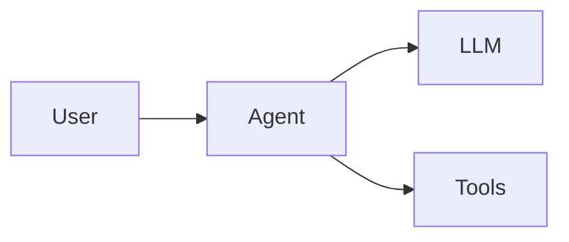
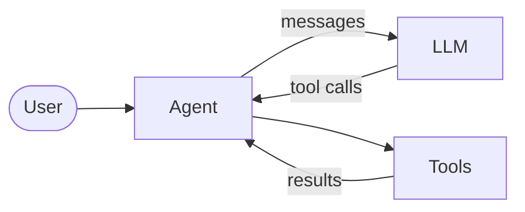
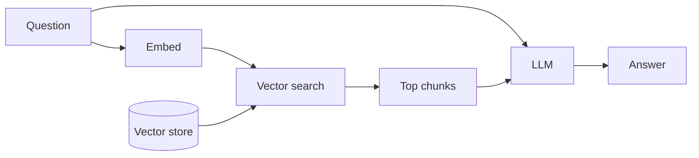
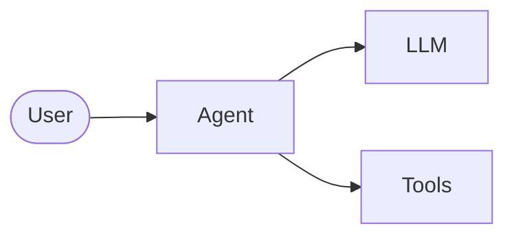
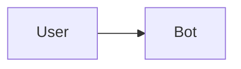
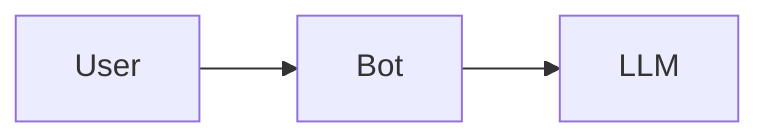
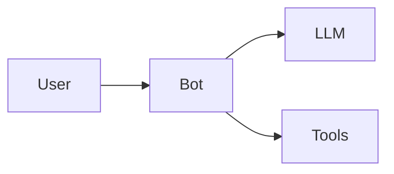
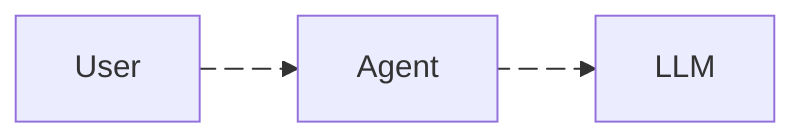

# slidev-addon-pele

A [Slidev](https://sli.dev) addon that draws your Mermaid diagrams with [Pele](https://github.com/obsidianmd/pele) instead of mermaid.js, and lets each diagram step on click the way code blocks do.

- Your existing ` ```mermaid ` blocks render with Pele, with no other change.
- Diagrams are small, self-contained SVG that fit the column they sit in and follow the Slidev theme and dark mode.
- ` ```mermaid {user|agent,llm|*} ` emphasises or reveals parts of the diagram click by click.
- No mermaid.js in your deck: each diagram type loads only its own code.

## Install

```bash
npm install slidev-addon-pele
```

Then add it to the deck's headmatter (the frontmatter of the first slide):

```yaml
---
addons:
  - pele
---
```

Requires Slidev 52.15 or later.

### pnpm and Slidev 53

With pnpm, every Slidev 53 deck currently fails to start or build with `ERR_PACKAGE_PATH_NOT_EXPORTED ./lib/token.mjs`, with or without this addon ([slidevjs/slidev#2761](https://github.com/slidevjs/slidev/issues/2761)). Add markdown-it 14 to the deck until Slidev fixes it:

```bash
pnpm add markdown-it@^14.3.3
```

npm installs are not affected.

## Diagram blocks

Every ` ```mermaid ` block, and every ` ```pele ` block, is a **diagram block**. Write Mermaid syntax as usual; what Slidev documents for Mermaid blocks keeps working:

````md

````

` ```pele ` is the same, except that it always draws with Pele, whatever the deck's opt-out says.

Pele draws all 33 diagram types it knows: flowchart, sequence, class, state, er, gantt, pie, mindmap, timeline, journey, gitGraph, xychart, quadrantChart, architecture, c4, kanban, sankey, block, packet, requirement, radar, treemap and more.

A diagram fills the width it is given and never grows past its natural size. In a column narrower than 640 px, a left-to-right flowchart turns top-to-bottom. Labels are measured with the slide's own font.

## Steps

Steps use the grammar of Slidev's code line highlighting: `|` separates steps, `,` joins the parts of one step, and `*` names every part. The first step shows before any click; each later step takes one click.

````md

````

What a step names:

- **Flowcharts**: node ids (`agent` in `agent[Agent]`) and subgraph ids. An edge lights up by itself once both its ends are active. To step an edge yourself, give it a name (`user e1@--> agent`) and write `e1` in a step.
- **Sequence diagrams**: message numbers, `1` for the first arrow in the source, and ranges such as `2-4`. A note shows with the message before it; participants stay visible.
- **Every other type**: the ids Pele draws on its parts, such as class names, state ids, gantt task ids, pie slice labels or kanban card ids. The [skill's step id reference](skills/slidev-addon-pele/references/step-ids.md) lists them per type.

A step id the diagram does not have prints a `[pele]` warning in the terminal and under the diagram, listing the ids it does have.

### Focus mode and reveal mode

By default steps use **focus mode**: the whole diagram is visible and each step's parts are emphasised while the rest recedes. `{reveal: true}` switches to **reveal mode**: parts stay hidden until their step arrives, and the diagram builds up click by click. Write steps first, then options:

````md

````

### Stepping code and a diagram together

Like two code blocks on one slide, a code block and a diagram step one after the other. Give both `{at:1}` to step them together, as Slidev documents for code blocks:

````md
```python {1-2|3-4|5-7|*}{at:1}
def run(question):
    messages = [user(question)]
    while True:
        reply = llm(messages)
        if not reply.tool_calls:
            return reply.text
        messages += call_tools(reply.tool_calls)
```


````

Overview, presenter view, going back a slide and PDF export (without `--with-clicks`) show the last step, as Slidev does for code.

## Magic-move between versions

To grow or rearrange a diagram click by click, write Slidev's own ` ````md magic-move ` fence with diagram blocks inside. Each diagram block is a **version**; each click moves to the next one, and parts with the same id glide from where they were to where they are now, while parts in only one version fade in or out:

`````md
````md magic-move





````
`````

- Keep a part's id the same across versions (`bot` above) so it glides rather than fading out and back in.
- As in Slidev, `{at: 2}` and `{duration: 1200}` go on the outer fence (` ````md magic-move {at: 2} `), and `magicMoveDuration` in the headmatter sets the default duration. Line ranges and the `[title]` have no effect on diagrams.
- Every version uses the deck's preset (`pele.theme`). Steps and options on a version are ignored with a `[pele]` warning: step through a diagram on a slide of its own.
- Flowchart versions all keep one direction, so no version flips to top-to-bottom on its own in a narrow column.
- The addon takes over the fence only when every version is a diagram block it would draw. If one version is handed back to mermaid.js (`renderer: 'mermaid'`, the deck's opt-out, ZenUML) or is not a diagram block at all, the whole fence is left to Slidev's magic-move, which shows it as code.
- Viewers who prefer reduced motion see each version swap in at once. Export draws each version at rest: the last one, or one page per version with `--with-clicks`.

## Presets

A **preset** is a named set of diagram colours:

- `auto` (the default) follows the Slidev theme: the slide's text colour for text and lines, tints of it for fills, the theme's primary colour as the accent, and Slidev's page background.
- `flexoki` uses the [Flexoki](https://stephango.com/flexoki) palette and draws the diagram as a card.

Both follow Slidev's dark mode live, without drawing the diagram again. Choose one for the deck with `pele: { theme: flexoki }` in the headmatter, or for one block with `{theme: 'flexoki'}`. Mermaid's theme names work too and map to the nearest preset: `default` and `base` to `auto`, `neutral` to `auto` in greys, `dark` to `auto` forced dark, and `forest` to `auto` with a warning.

### Your own colours

Pele takes every colour from `--pele-*` CSS variables. Set them on `.pele-diagram`, in the deck's `style.css` or a slide's `<style>`; your rules always win over the preset:

```css
.pele-diagram {
  --pele-accent: tomato;
}
html.dark .pele-diagram {
  --pele-bg: #000;
}
```

The variables are `--pele-bg`, `--pele-fg`, `--pele-muted`, `--pele-line`, `--pele-surface`, `--pele-surface-alt`, `--pele-border`, `--pele-accent`, `--pele-critical`, `--pele-error`, `--pele-font`, `--pele-font-mono`, `--pele-radius` and `--pele-series-1` to `--pele-series-8`; [the theming reference](skills/slidev-addon-pele/references/theming.md) says what each colours. Parts of a stepping diagram carry `pele-step-active`, `pele-step-receding` or `pele-step-hidden`, if you want to restyle steps.

## Animated edges

Mark a flowchart edge with Mermaid's syntax and its dashes move:

````md

````

`animation: fast` and `slow` set the speed, as in Mermaid. Pele reads these properties but draws the edge still: the movement comes from this addon, not from Pele. Viewers who prefer reduced motion see still edges.

## Options

Options go in braces after the steps, or alone: ` ```mermaid {a|b}{reveal: true, scale: 0.8} `. As in Slidev, the braces are a JavaScript object; quote strings with single quotes (`{theme: 'dark'}`), since a double quote ends the attribute Slidev writes them into and breaks the slide. Any other key prints a `[pele]` warning.

| option     | values                                                                                                      | default                                |
| ---------- | ----------------------------------------------------------------------------------------------------------- | -------------------------------------- |
| `scale`    | a number above 0: the diagram's height is its natural height times this, as in Slidev                       | natural size                           |
| `theme`    | `'auto'`, `'flexoki'`, or a Mermaid theme name (`'default'`, `'base'`, `'neutral'`, `'dark'`, `'forest'`)   | the deck's `pele.theme`, else `'auto'` |
| `reveal`   | `true` for reveal mode                                                                                      | focus mode                             |
| `renderer` | `'mermaid'` to draw this block with mermaid.js; `'pele'` to draw it with Pele when the deck opts out        | Pele                                   |
| `at`       | the click the second step lands on, as `at` on Slidev code blocks: a number is absolute, `'+n'` is relative | `'+1'`                                 |

Deck settings go under `pele` in the headmatter:

| setting        | values                                                                                   |
| -------------- | ---------------------------------------------------------------------------------------- |
| `pele.theme`   | the preset for every block; any `theme` value above. A block's `theme` wins.             |
| `pele.mermaid` | `false` to draw ` ```mermaid ` blocks with mermaid.js; ` ```pele ` blocks still use Pele |

## Opting out

Pele does not draw everything mermaid.js does. To keep mermaid.js for a diagram:

- one block: ` ```mermaid {renderer: 'mermaid'} `;
- the whole deck: `pele: { mermaid: false }` in the headmatter, then ` ```pele ` (or `{renderer: 'pele'}`) for the blocks you still want drawn by Pele.

mermaid.js cannot step, so a block handed back to it draws whole and its steps are dropped with a warning. mermaid.js loads only on slides that use it.

What needs mermaid.js:

- **ZenUML** blocks go to mermaid.js automatically. Slidev's mermaid.js draws them only when the `@mermaid-js/mermaid-zenuml` plugin is registered; without it the slide shows an error and `slidev export` hangs on it.
- HTML labels, click callbacks, and Mermaid's `themeVariables`.
- Configuration in `setup/mermaid.ts`, which configures mermaid.js only.

## For AI agents

This repo ships an agent skill that teaches the addon's step grammar, options and presets, and how to check a deck. Install it into your agent with:

```bash
npx skills add arthurbm/slidev-addon-pele
```

The skill is also in the npm package, at `node_modules/slidev-addon-pele/skills/slidev-addon-pele/SKILL.md`.

## License

MIT
