# Mermaid syntax. Pele rendering. Slidev clicks.

---

# A ` ```mermaid ` block, drawn by Pele

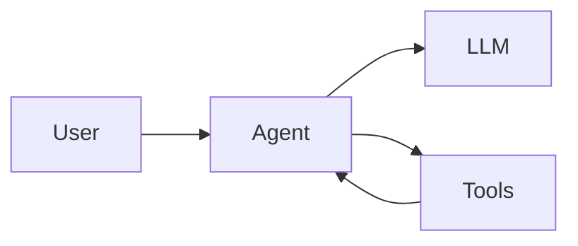

---

# A ` ```pele ` block in a narrow column

<div class="grid grid-cols-[1fr_320px] gap-8">
<div>

The same left-to-right flowchart turns top-to-bottom when its column is too narrow.

</div>
<div>

```pele
flowchart LR
  question[Question] --> retrieve[Retrieve documents]
  retrieve --> rerank[Rerank]
  rerank --> answer[Answer]
```

</div>
</div>

---
routeAlias: dark-mode
class: dark-mode
---

<script setup>
import { useDarkMode } from "@slidev/client";

const { isDark, toggleDark } = useDarkMode();
</script>

# Dark mode, without a re-render

<div class="flex items-center gap-4 mb-6">
  <button class="px-3 py-1 rounded border border-current opacity-80 hover:opacity-100" @click="toggleDark()">
    Switch to {{ isDark ? "light" : "dark" }} mode
  </button>
  <span class="opacity-60">or press <kbd>d</kbd></span>
</div>

<div class="grid grid-cols-2 gap-8">
<div>

`auto` follows the Slidev theme

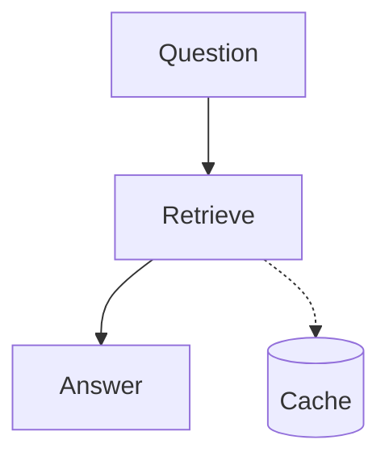

</div>
<div>

`{theme: 'flexoki'}`


</div>
</div>

---
routeAlias: animated-edges
class: animated-edges
---

# Animated edges


Pele reads `animate: true` but draws the edge still; the addon moves its dashes. They stand still for viewers who prefer reduced motion.

---
routeAlias: tool-loop
---

# Code and diagram, step by step

<div class="grid grid-cols-2 gap-8 items-center">
<div>

```python {1-2|3-4|5-7|*}{at:1}
def run(question):
    messages = [user(question)]
    while True:
        reply = llm(messages)
        if not reply.tool_calls:
            return reply.text
        messages += call_tools(reply.tool_calls)
```

</div>
<div>

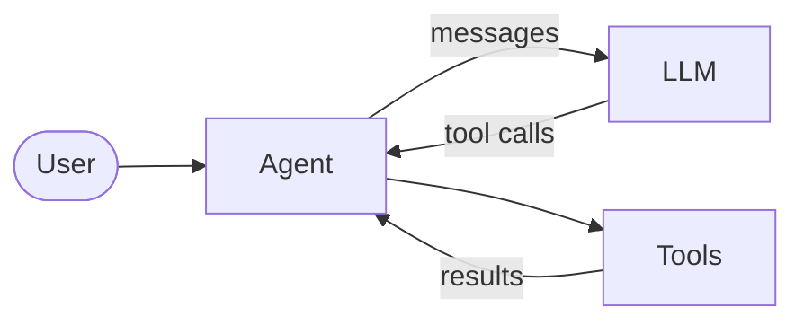

</div>
</div>

---
routeAlias: rag-reveal
---

# A RAG flow, built up click by click

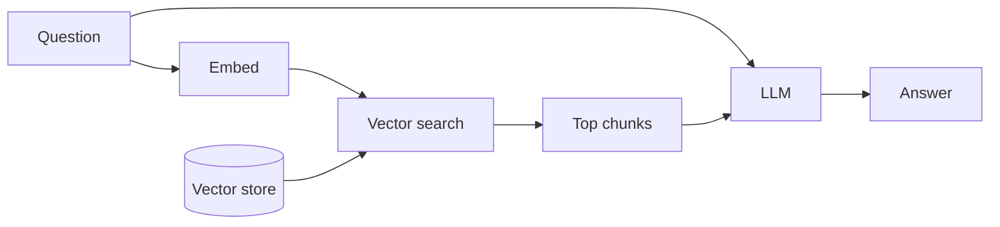

---
routeAlias: sequence-steps
---

# A tool call, message by message

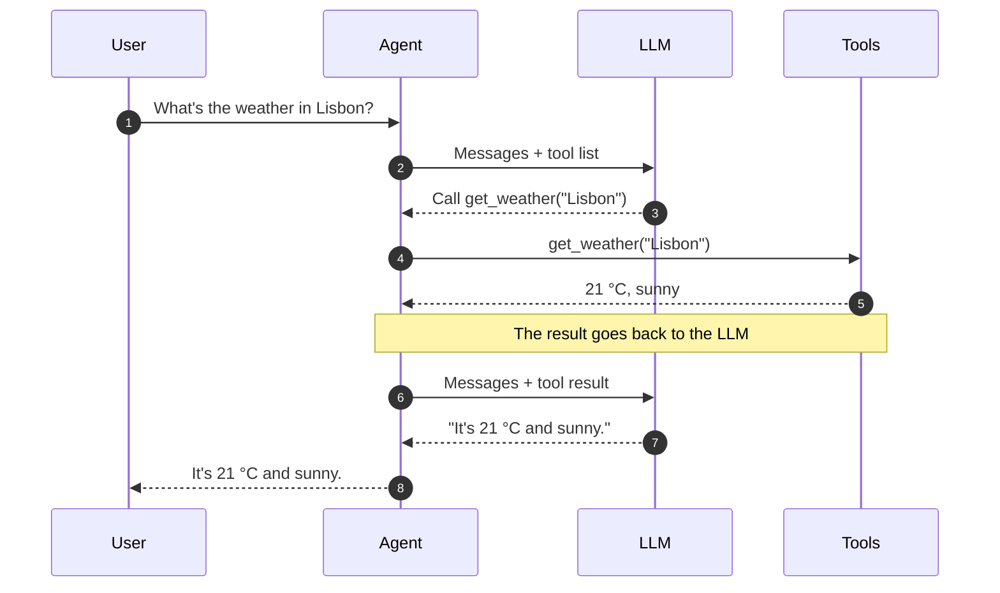

---
routeAlias: magic-move
class: magic-move
---

# A bot, growing click by click

````md magic-move
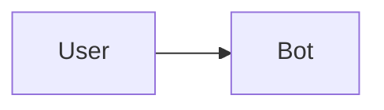
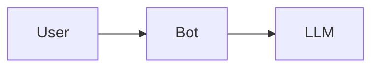
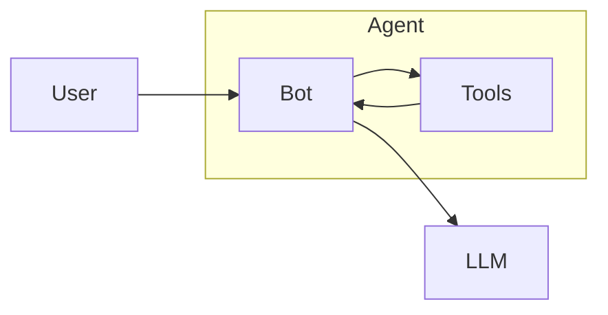
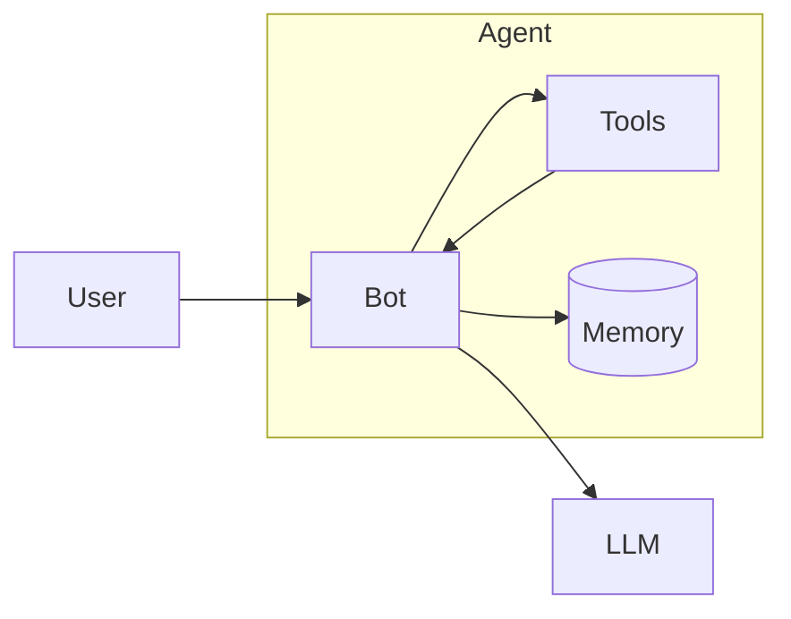
````

Slidev's own ` ````md magic-move `, with diagram blocks as its versions: nodes glide to their new places.

---
layout: two-cols-header
routeAlias: two-renderers
class: two-renderers
---

# Same source, two renderers

::left::

mermaid.js

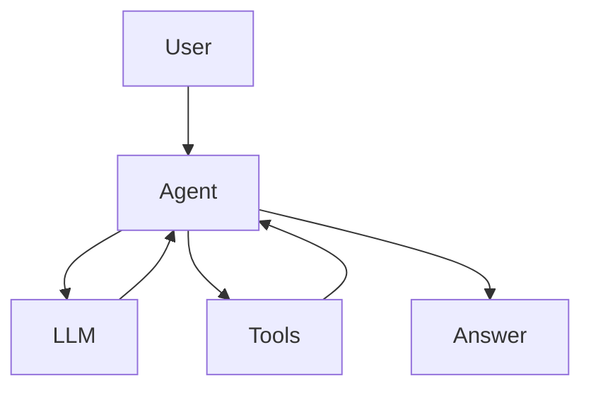

::right::

Pele


---
routeAlias: gallery
class: gallery
---

# Every diagram type Pele draws

<div class="gallery-grid">
<figure>

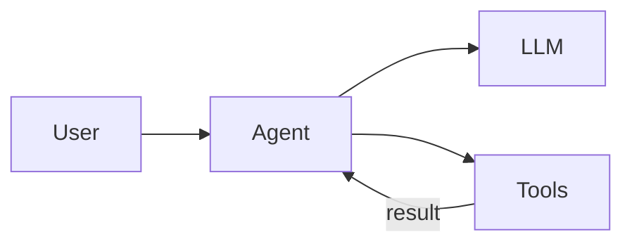

<figcaption>flowchart</figcaption>
</figure>

<figure>

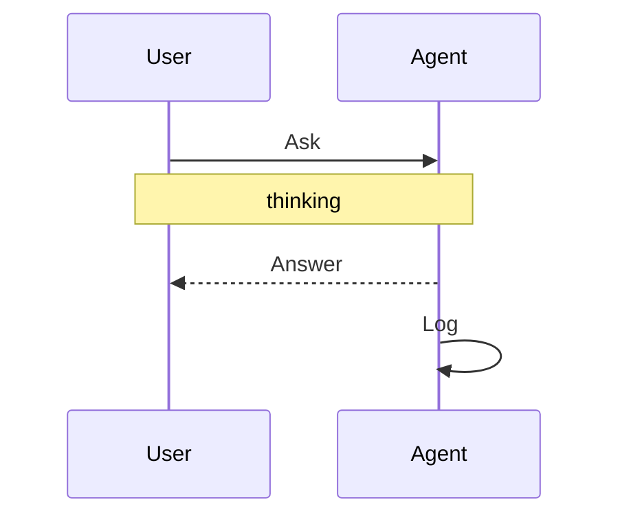

<figcaption>sequence</figcaption>
</figure>

<figure>

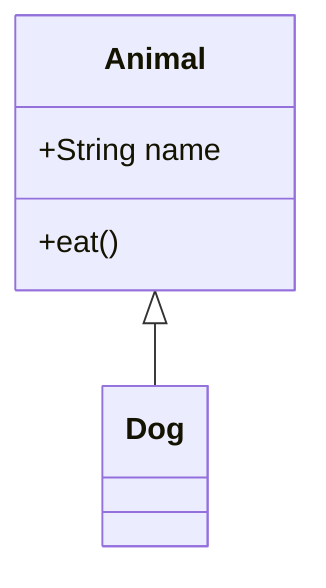

<figcaption>class</figcaption>
</figure>

<figure>

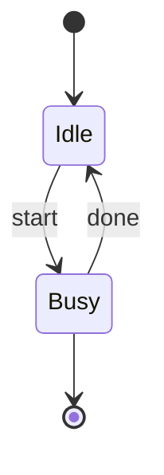

<figcaption>state</figcaption>
</figure>

<figure>

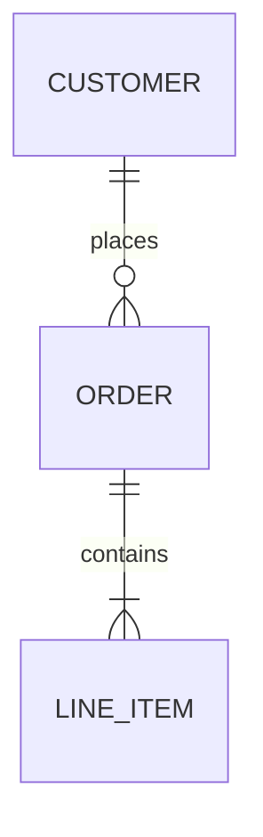

<figcaption>er</figcaption>
</figure>

<figure>

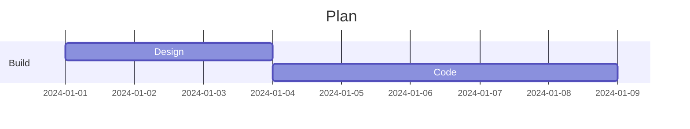

<figcaption>gantt</figcaption>
</figure>

<figure>

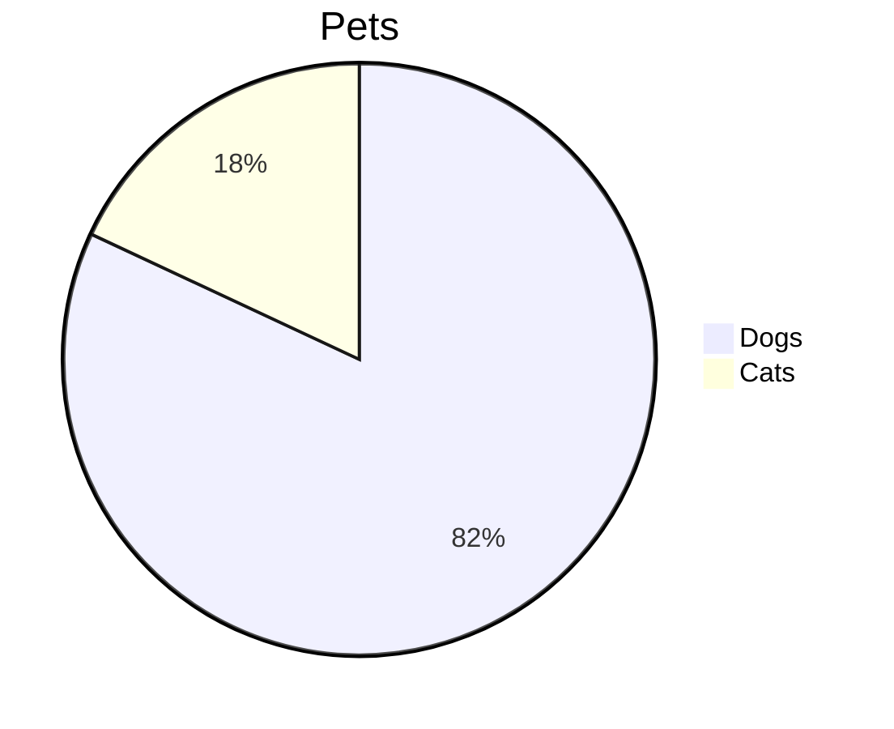

<figcaption>pie</figcaption>
</figure>

<figure>

```mermaid
mindmap
  root((Pele))
    Render
      SVG
    Themes
```

<figcaption>mindmap</figcaption>
</figure>

<figure>

```mermaid
timeline
  title History
  2002 : LinkedIn
  2004 : Facebook
```

<figcaption>timeline</figcaption>
</figure>

<figure>

```mermaid
journey
  title My day
  section Work
    Make tea: 5: Me
    Do work: 1: Me, Cat
```

<figcaption>journey</figcaption>
</figure>

<figure>

```mermaid
quadrantChart
  title Reach
  x-axis Low --> High
  y-axis Low --> High
  quadrant-1 Expand
  quadrant-2 Promote
  quadrant-3 Re-evaluate
  quadrant-4 Improve
  Campaign A: [0.3, 0.6]
  Campaign B: [0.7, 0.2]
```

<figcaption>quadrantChart</figcaption>
</figure>

<figure>

```mermaid
xychart-beta
  title "Sales"
  x-axis [jan, feb, mar]
  y-axis "Revenue" 0 --> 100
  bar "Orders" [10, 50, 80]
  line "Trend" [10, 50, 80]
```

<figcaption>xychart</figcaption>
</figure>

<figure>

```mermaid
architecture-beta
  group api(cloud)[API]
  service db(database)[Database] in api
  service server(server)[Server] in api
  db:L -- R:server
```

<figcaption>architecture</figcaption>
</figure>

<figure>

```mermaid
requirementDiagram
  requirement test_req {
    id: 1
    text: the test text.
    risk: high
    verifymethod: test
  }
  element test_entity {
    type: simulation
  }
  test_entity - satisfies -> test_req
```

<figcaption>requirement</figcaption>
</figure>

<figure>

```mermaid
sankey-beta
A,B,10
A,C,5
B,D,7
```

<figcaption>sankey</figcaption>
</figure>

<figure>

```mermaid
packet-beta
  0-15: "Source Port"
  16-31: "Destination Port"
```

<figcaption>packet</figcaption>
</figure>

<figure>

```mermaid
radar-beta
  axis a["A"], b["B"], c["C"]
  curve x["X"]{1, 2, 3}
  curve y["Y"]{3, 2, 1}
```

<figcaption>radar</figcaption>
</figure>

<figure>

```mermaid
treemap-beta
"Root"
    "A": 20
    "B": 10
```

<figcaption>treemap</figcaption>
</figure>

<figure>

```mermaid
gitGraph
  commit id: "init"
  branch feature
  commit id: "work"
  checkout main
  merge feature
```

<figcaption>gitGraph</figcaption>
</figure>

<figure>

```mermaid
C4Context
  title System Context
  Person(user, "User")
  System(app, "App")
  Rel(user, app, "Uses")
```

<figcaption>c4</figcaption>
</figure>

<figure>

```mermaid
block-beta
  columns 3
  a["A"] b["B"] c["C"]
  a --> b
```

<figcaption>block</figcaption>
</figure>

<figure>

```mermaid
kanban
  todo[Todo]
    t1[Write spec]
  done[Done]
    t2[Ship]
```

<figcaption>kanban</figcaption>
</figure>

<figure>

```mermaid
agentflow-beta TB
  check["Tests pass?"]@{ shape: decision }
  ship["Ship it"]@{ shape: action }
  check -- yes --> ship
```

<figcaption>agentflow</figcaption>
</figure>

<figure>

```mermaid
cynefin-beta
  complex
    "Probe"
  clear
    "Restart"
```

<figcaption>cynefin</figcaption>
</figure>

<figure>

```mermaid
eventmodeling
tf 01 ui CartUI
tf 02 cmd AddItem
tf 03 evt ItemAdded
```

<figcaption>eventmodeling</figcaption>
</figure>

<figure>

```mermaid
info
```

<figcaption>info</figcaption>
</figure>

<figure>

```mermaid
ishikawa-beta
    Blurry Photo
    Process
        Out of focus
    User
        Shaky hands
```

<figcaption>ishikawa</figcaption>
</figure>

<figure>

```mermaid
railroad-ebnf-beta
letter = "a" | "b" ;
word = letter , { letter } ;
```

<figcaption>railroad</figcaption>
</figure>

<figure>

```mermaid
swimlane-beta LR
  subgraph Buyer
    choose[Choose]
    pay[Pay]
  end
  subgraph Store
    ship[Ship]
  end
  choose --> ship
  ship --> pay
```

<figcaption>swimlane</figcaption>
</figure>

<figure>

```mermaid
treeView-beta
    src/
        index.js
    package.json
```

<figcaption>treeView</figcaption>
</figure>

<figure>

```mermaid
usecase-beta
actor Customer
Reset("Reset password")
Customer --> Reset
```

<figcaption>usecase</figcaption>
</figure>

<figure>

```mermaid
venn-beta
  set A["Alpha"]:20
  set B["Beta"]:12
  union A,B["AB"]:3
```

<figcaption>venn</figcaption>
</figure>

<figure>

```mermaid
wardley-beta
title Tea
anchor Business [0.95, 0.63]
component Cup of Tea [0.79, 0.61]
component Water [0.38, 0.82]
Business->Cup of Tea
Cup of Tea->Water
```

<figcaption>wardley</figcaption>
</figure>

</div>

<style>
.gallery-grid {
  display: grid;
  grid-template-columns: repeat(7, minmax(0, 1fr));
  gap: 0.25rem 0.75rem;
  margin-top: 0.5rem;
}
.gallery-grid figure {
  margin: 0;
  min-width: 0;
}
.gallery-grid :deep(svg.pele) {
  display: block;
  width: 100%;
  height: 72px !important;
}
.gallery-grid figcaption {
  font-size: 0.55rem;
  line-height: 1;
  opacity: 0.6;
  text-align: center;
}
</style>
