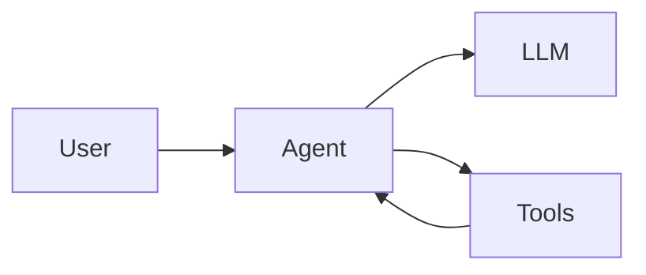
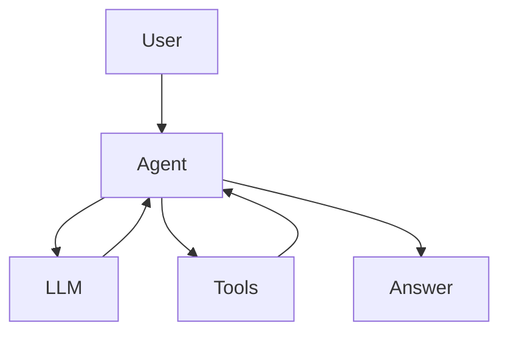

# Mermaid syntax. Pele rendering. Slidev clicks.

---

# A ` ```mermaid ` block, drawn by Pele



---

# A ` ```pele ` block in a narrow column

<div class="grid grid-cols-[1fr_320px] gap-8">
<div>

The same left-to-right flowchart turns top-to-bottom when its column is too narrow.

</div>
<div>

```pele
flowchart LR
  question[Question] --> retrieve[Retrieve documents]
  retrieve --> rerank[Rerank]
  rerank --> answer[Answer]
```

</div>
</div>

---
layout: two-cols-header
---

# Same source, two renderers

::left::

mermaid.js



::right::

Pele


