<div class="cover">

<div class="fence">```mermaid {model|tool|harness|*}</div>

<h1 class="cover__title">
  <span>Mermaid syntax.</span>
  <span>Pele rendering.</span>
  <span>Slidev clicks.</span>
</h1>

<div class="cover__lede">

**slidev-addon-pele** draws the diagram blocks in your Slidev deck with Pele, Obsidian's new renderer, and lets each one move click by click.

</div>

<div class="cover__meta">github.com/arthurbm/slidev-addon-pele</div>

</div>

<style>
.cover {
  display: flex;
  flex-direction: column;
  justify-content: center;
  height: 100%;
  max-width: 40rem;
}
.slidev-layout.slidev-layout .cover__title {
  display: grid;
  font-size: 3.6rem;
  line-height: 1.02;
  margin: 0.4rem 0 0;
}
.cover__title span:last-child {
  color: var(--terracotta);
}
.cover__lede {
  margin-top: 1.6rem;
  max-width: 34rem;
  font-size: 1rem;
  line-height: 1.55;
}
.cover__lede p {
  margin: 0;
}
.cover__meta {
  margin-top: 2rem;
  padding-top: 0.8rem;
  border-top: 1px solid var(--rule);
  font-family: var(--font-mono);
  font-size: 0.7rem;
  color: var(--ink-3);
}
</style>

<!--
Cover. The fence line in the corner is the whole idea: Mermaid syntax, steps in braces, as in code blocks.
-->

---
layout: two-cols-header
routeAlias: two-renderers
class: two-renderers
---

<div class="fence">```mermaid {renderer: 'mermaid', scale: 0.65} beside ```mermaid {scale: 0.65}</div>

# Same source, two renderers

::left::

<div class="caption">mermaid.js, Slidev's default</div>


::right::

<div class="caption">Pele, with slidev-addon-pele</div>

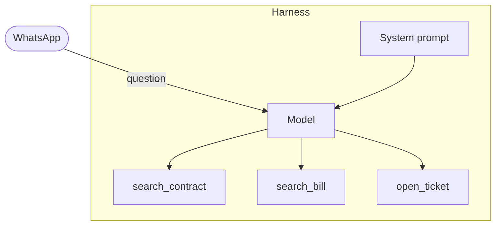

<!--
The hook. Same Mermaid source on both sides; only the renderer changes. Pele's drawing picks up the deck's fonts and paper colours from CSS variables.
-->

---
routeAlias: install
class: install
---

<div class="fence">addons: [pele]</div>

# One line in the headmatter

<div class="install__grid">
<div>

````md magic-move
```yaml
---
title: My talk
theme: default
---
```
```yaml
---
title: My talk
theme: default
addons:
  - pele
---
```
````

</div>
<div class="install__steps">

<div class="caption">install</div>

```bash
npm install slidev-addon-pele
```

<div class="note">

Every ` ```mermaid ` block in the deck is now drawn by Pele. No slide changes; ` {renderer: 'mermaid'} ` sends one block back to mermaid.js.

</div>
</div>
</div>

<style>
.install__grid {
  display: grid;
  grid-template-columns: 1.1fr 1fr;
  gap: 2.5rem;
  align-items: start;
  margin-top: 2.5rem;
}
.install__grid :is(pre, .slidev-code) {
  --slidev-code-font-size: 1.15rem;
  --slidev-code-line-height: 1.6;
  font-size: 1.15rem;
  line-height: 1.6;
}
.install__steps .note {
  margin-top: 1.2rem;
}
</style>

---
routeAlias: tool-loop
class: tool-loop
---

<div class="fence">```mermaid {model|model,tool|tool,harness|harness,result,model|*}{at:1, scale: 0.8}</div>

# Code and diagram, step by step

<div class="tool-loop__grid">
<div>

```python {2-5|6|7|8|*}{at:1}
def agent(messages):
    while True:
        reply = model(messages)
        if not reply.tool_calls:
            return reply.text
        call = reply.tool_calls[0]
        result = harness.run(call)
        messages.append(result)
```

<div class="note">

Line steps on the code, node steps on the diagram, both `{at:1}`: one click moves both.

</div>
</div>
<div>

```mermaid {model|model,tool|tool,harness|harness,result,model|*}{at:1, scale: 0.8}
flowchart LR
  model[Model] -->|only writes structured text| tool["{tool: open_ticket, unit: 302B}"]
  tool -->|the harness runs it in the ERP| harness[Harness runs it]
  harness -->|tool result| result["{ticket: #4821, status: open}"]
  result -->|back into context, it decides again| model
```

</div>
</div>

<style>
.tool-loop__grid {
  display: grid;
  grid-template-columns: 1fr 1fr;
  gap: 2rem;
  align-items: center;
  min-height: 24rem;
}
.tool-loop__grid .note {
  margin-top: 0.8rem;
}
</style>

<!--
The tool-call loop from the Gen AI deck. The model only writes a tool call; the harness runs it and puts the result back into context.
-->

---
routeAlias: rag-reveal
class: rag-reveal
---

<div class="fence">```mermaid {docs,chunks|space|question|topk}{reveal: true}</div>

# RAG, built up click by click

<div class="centrepiece">

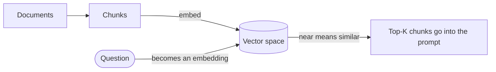

</div>

<div class="note">

`{reveal: true}`: parts stay hidden until their step. An edge appears once both of its ends have.

</div>

---
routeAlias: sequence-steps
class: sequence-steps
---

<div class="fence">```mermaid {1|2-3|4-5|6-7|8|*}</div>

# A tool call, message by message

<div class="centrepiece">

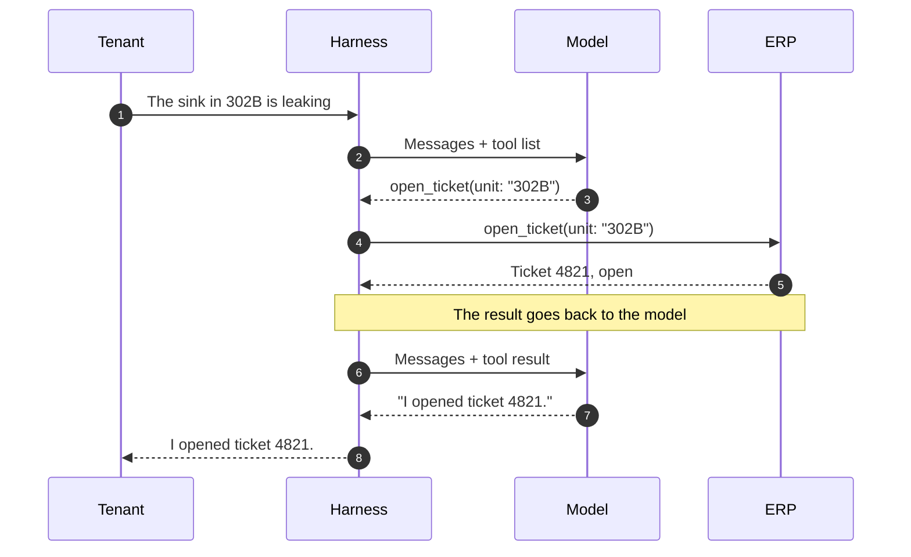

</div>

---
routeAlias: magic-move
class: magic-move
---

<div class="fence">````md magic-move, with ```mermaid blocks inside</div>

# A bot, growing click by click

<div class="centrepiece">

````md magic-move
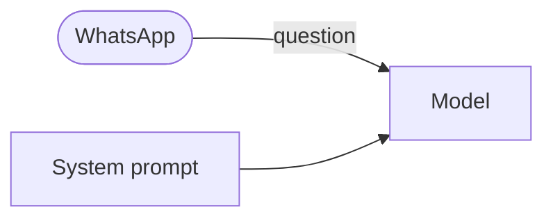
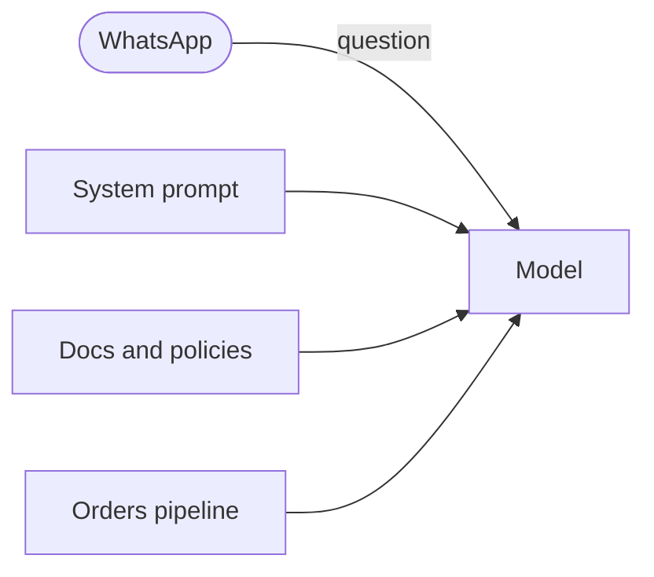
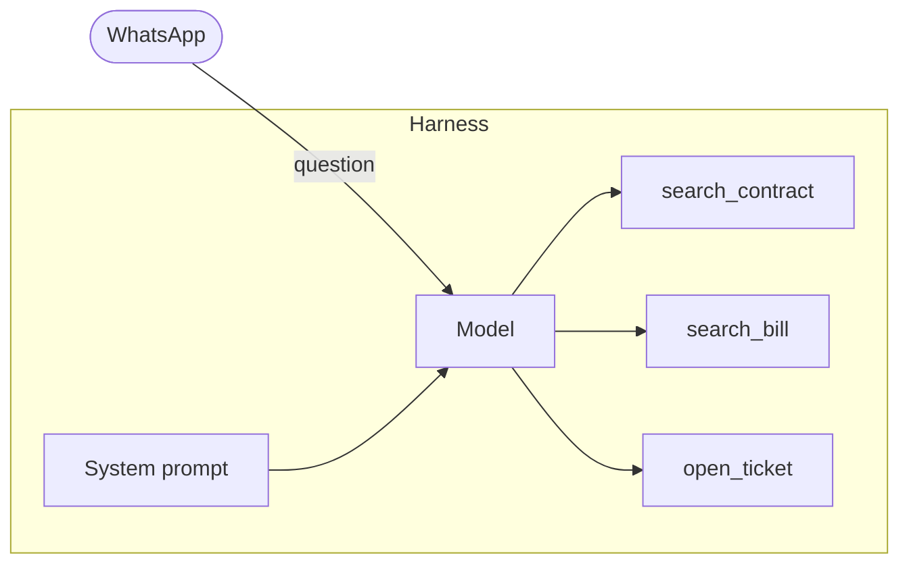
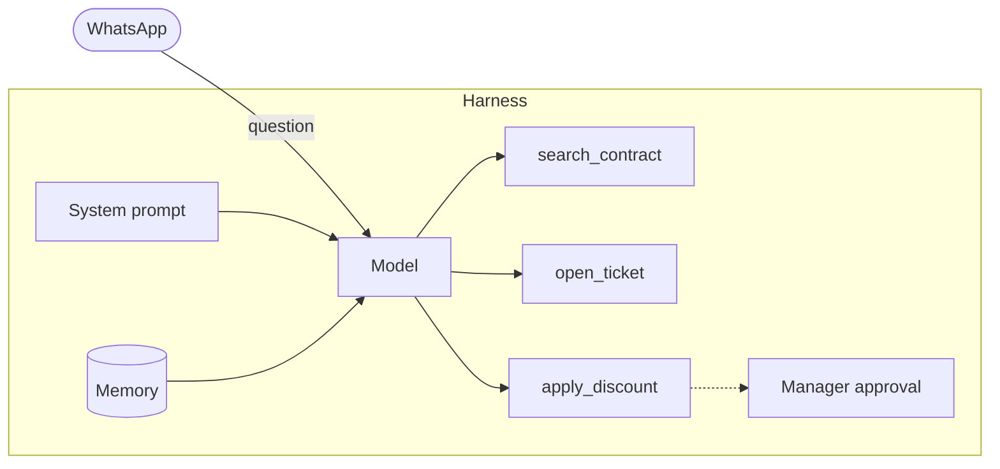
````

</div>

<div class="note">

Slidev's own magic-move, with diagram blocks as its versions: nodes glide to their new places.

</div>

---
routeAlias: responsive
class: responsive
---

<div class="fence">the same block, at two widths</div>

# Diagrams fit the room they get

<div class="responsive__grid">
<div>

<div class="caption">a wide column: left to right</div>

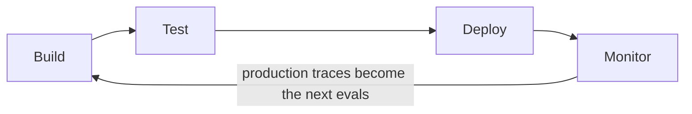

<div class="note mt-8">

Pele lays the diagram out again whenever its width changes. When a left-to-right flowchart does not fit in less than 640px, it turns top to bottom, so its labels keep their size instead of shrinking.

</div>
</div>
<div>

<div class="caption">220px column: top to bottom</div>

```pele
flowchart LR
  build[Build] --> test[Test]
  test --> deploy[Deploy]
  deploy --> monitor[Monitor]
  monitor -->|production traces become the next evals| build
```

</div>
</div>

<style>
.responsive__grid {
  display: grid;
  grid-template-columns: 1fr 220px;
  gap: 2.5rem;
  align-items: start;
}
</style>

---
routeAlias: dark-mode
class: dark-mode
---

<script setup>
import { useDarkMode } from "@slidev/client";

const { isDark, toggleDark } = useDarkMode();
</script>

<div class="fence">press d</div>

# Dark mode, without a re-render

<div class="dark-mode__switch">
  <button @click="toggleDark()">
    Switch to {{ isDark ? "light" : "dark" }} mode
  </button>
  <span class="note">Colours are CSS variables: the SVG stays, only the paint changes.</span>
</div>

<div class="grid grid-cols-2 gap-10">
<div>

<div class="caption">the deck's own CSS: paper and ink</div>

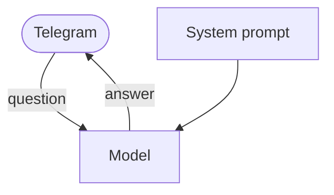

</div>
<div>

<div class="caption">{theme: 'flexoki'}, a preset</div>


</div>
</div>

<style>
.dark-mode__switch {
  display: flex;
  align-items: center;
  gap: 1rem;
  margin-bottom: 1.5rem;
}
.dark-mode__switch button {
  padding: 0.3rem 0.8rem;
  border: 1px solid var(--terracotta);
  border-radius: 3px;
  color: var(--terracotta);
  font-family: var(--font-mono);
  font-size: 0.75rem;
  transition: background-color 200ms var(--ease-out);
}
.dark-mode__switch button:hover,
.dark-mode__switch button:focus-visible {
  background: var(--terracotta-wash);
}
</style>

---
routeAlias: animated-edges
class: animated-edges
---

<div class="fence">e1@{ animate: true }</div>

# Animated edges

<div class="centrepiece">

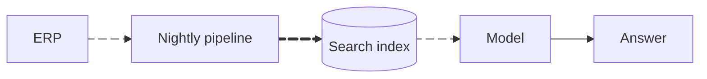

</div>

<div class="note">

Pele reads `animate: true` but draws the edge still; the addon moves its dashes. They stand still for viewers who prefer reduced motion.

</div>

---
routeAlias: gallery
class: gallery
---

<div class="fence">every type Pele 1.6 draws, as ```mermaid blocks</div>

# Thirty-three diagram types

<div class="gallery-grid">
<figure>

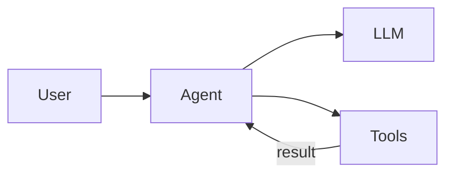

<figcaption>flowchart</figcaption>
</figure>

<figure>

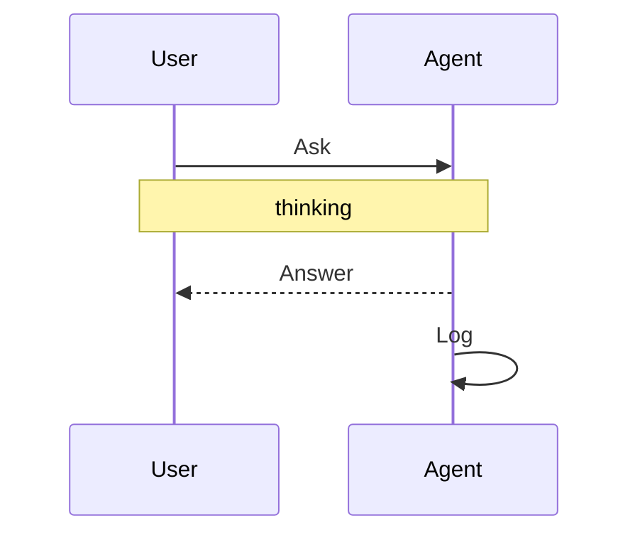

<figcaption>sequence</figcaption>
</figure>

<figure>

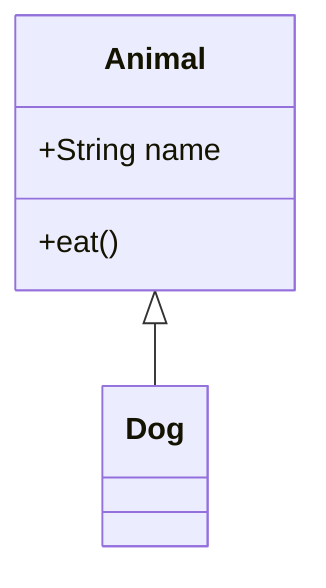

<figcaption>class</figcaption>
</figure>

<figure>

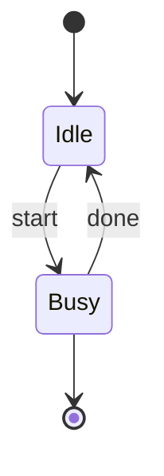

<figcaption>state</figcaption>
</figure>

<figure>

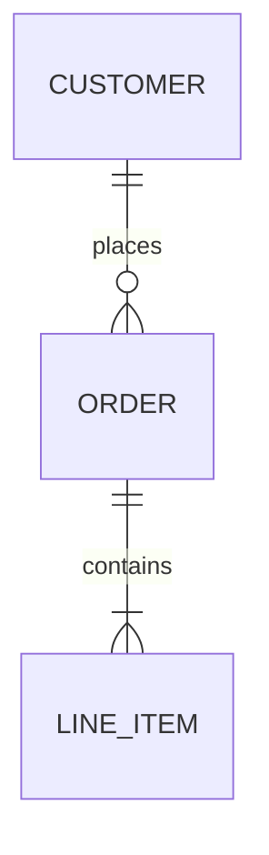

<figcaption>er</figcaption>
</figure>

<figure>

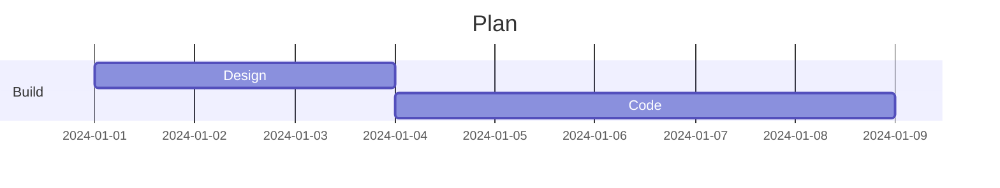

<figcaption>gantt</figcaption>
</figure>

<figure>

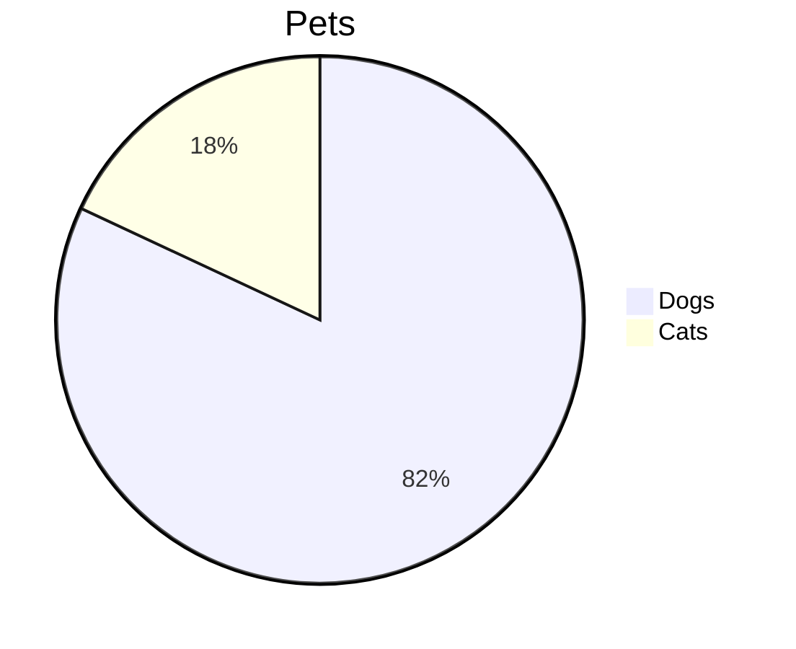

<figcaption>pie</figcaption>
</figure>

<figure>

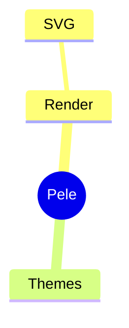

<figcaption>mindmap</figcaption>
</figure>

<figure>

```mermaid
timeline
  title History
  2002 : LinkedIn
  2004 : Facebook
```

<figcaption>timeline</figcaption>
</figure>

<figure>

```mermaid
journey
  title My day
  section Work
    Make tea: 5: Me
    Do work: 1: Me, Cat
```

<figcaption>journey</figcaption>
</figure>

<figure>

```mermaid
quadrantChart
  title Reach
  x-axis Low --> High
  y-axis Low --> High
  quadrant-1 Expand
  quadrant-2 Promote
  quadrant-3 Re-evaluate
  quadrant-4 Improve
  Campaign A: [0.3, 0.6]
  Campaign B: [0.7, 0.2]
```

<figcaption>quadrantChart</figcaption>
</figure>

<figure>

```mermaid
xychart-beta
  title "Sales"
  x-axis [jan, feb, mar]
  y-axis "Revenue" 0 --> 100
  bar "Orders" [10, 50, 80]
  line "Trend" [10, 50, 80]
```

<figcaption>xychart</figcaption>
</figure>

<figure>

```mermaid
architecture-beta
  group api(cloud)[API]
  service db(database)[Database] in api
  service server(server)[Server] in api
  db:L -- R:server
```

<figcaption>architecture</figcaption>
</figure>

<figure>

```mermaid
requirementDiagram
  requirement test_req {
    id: 1
    text: the test text.
    risk: high
    verifymethod: test
  }
  element test_entity {
    type: simulation
  }
  test_entity - satisfies -> test_req
```

<figcaption>requirement</figcaption>
</figure>

<figure>

```mermaid
sankey-beta
A,B,10
A,C,5
B,D,7
```

<figcaption>sankey</figcaption>
</figure>

<figure>

```mermaid
packet-beta
  0-15: "Source Port"
  16-31: "Destination Port"
```

<figcaption>packet</figcaption>
</figure>

<figure>

```mermaid
radar-beta
  axis a["A"], b["B"], c["C"]
  curve x["X"]{1, 2, 3}
  curve y["Y"]{3, 2, 1}
```

<figcaption>radar</figcaption>
</figure>

<figure>

```mermaid
treemap-beta
"Root"
    "A": 20
    "B": 10
```

<figcaption>treemap</figcaption>
</figure>

<figure>

```mermaid
gitGraph
  commit id: "init"
  branch feature
  commit id: "work"
  checkout main
  merge feature
```

<figcaption>gitGraph</figcaption>
</figure>

<figure>

```mermaid
C4Context
  title System Context
  Person(user, "User")
  System(app, "App")
  Rel(user, app, "Uses")
```

<figcaption>c4</figcaption>
</figure>

<figure>

```mermaid
block-beta
  columns 3
  a["A"] b["B"] c["C"]
  a --> b
```

<figcaption>block</figcaption>
</figure>

<figure>

```mermaid
kanban
  todo[Todo]
    t1[Write spec]
  done[Done]
    t2[Ship]
```

<figcaption>kanban</figcaption>
</figure>

<figure>

```mermaid
agentflow-beta TB
  check["Tests pass?"]@{ shape: decision }
  ship["Ship it"]@{ shape: action }
  check -- yes --> ship
```

<figcaption>agentflow</figcaption>
</figure>

<figure>

```mermaid
cynefin-beta
  complex
    "Probe"
  clear
    "Restart"
```

<figcaption>cynefin</figcaption>
</figure>

<figure>

```mermaid
eventmodeling
tf 01 ui CartUI
tf 02 cmd AddItem
tf 03 evt ItemAdded
```

<figcaption>eventmodeling</figcaption>
</figure>

<figure>

```mermaid
info
```

<figcaption>info</figcaption>
</figure>

<figure>

```mermaid
ishikawa-beta
    Blurry Photo
    Process
        Out of focus
    User
        Shaky hands
```

<figcaption>ishikawa</figcaption>
</figure>

<figure>

```mermaid
railroad-ebnf-beta
letter = "a" | "b" ;
word = letter , { letter } ;
```

<figcaption>railroad</figcaption>
</figure>

<figure>

```mermaid
swimlane-beta LR
  subgraph Buyer
    choose[Choose]
    pay[Pay]
  end
  subgraph Store
    ship[Ship]
  end
  choose --> ship
  ship --> pay
```

<figcaption>swimlane</figcaption>
</figure>

<figure>

```mermaid
treeView-beta
    src/
        index.js
    package.json
```

<figcaption>treeView</figcaption>
</figure>

<figure>

```mermaid
usecase-beta
actor Customer
Reset("Reset password")
Customer --> Reset
```

<figcaption>usecase</figcaption>
</figure>

<figure>

```mermaid
venn-beta
  set A["Alpha"]:20
  set B["Beta"]:12
  union A,B["AB"]:3
```

<figcaption>venn</figcaption>
</figure>

<figure>

```mermaid
wardley-beta
title Tea
anchor Business [0.95, 0.63]
component Cup of Tea [0.79, 0.61]
component Water [0.38, 0.82]
Business->Cup of Tea
Cup of Tea->Water
```

<figcaption>wardley</figcaption>
</figure>

</div>

<style>
.gallery-grid {
  display: grid;
  grid-template-columns: repeat(7, minmax(0, 1fr));
  gap: 0.35rem 0.75rem;
  margin-top: -0.25rem;
}
.gallery-grid figure {
  margin: 0;
  min-width: 0;
}
.gallery-grid :deep(svg.pele) {
  display: block;
  width: 100%;
  height: 64px !important;
}
.gallery-grid figcaption {
  margin-top: 0.15rem;
  font-family: var(--font-mono);
  font-size: 0.5rem;
  line-height: 1;
  color: var(--ink-3);
  text-align: center;
}
</style>

---
routeAlias: tokens
class: tokens
---

<script setup>
import counts from "./tokens/counts.json";
import excalidraw from "./tokens/tool-loop.excalidraw?raw";
import mermaid from "./tokens/tool-loop.mmd?raw";

const number = (value) => value.toLocaleString("en-US");
const ratio = Math.round(counts.excalidraw.tokens / counts.mermaid.tokens);
const excerpt = excalidraw.split("\n").slice(0, 40).join("\n");
</script>

<div class="fence">pnpm tokens</div>

# The same diagram, {{ ratio }}× fewer tokens

<div class="tokens__grid">
<section class="tokens__side">
  <div class="caption">Excalidraw JSON, {{ counts.excalidraw.file }}</div>
  <pre class="tokens__source tokens__source--cut">{{ excerpt }}</pre>
  <div class="tokens__count">
    <strong>{{ number(counts.excalidraw.tokens) }}</strong> tokens
    <span>{{ number(counts.excalidraw.bytes) }} bytes</span>
  </div>
</section>
<section class="tokens__side tokens__side--mermaid">
  <div class="caption">Mermaid syntax, {{ counts.mermaid.file }}</div>
  <pre class="tokens__source">{{ mermaid }}</pre>
  <div class="tokens__count">
    <strong>{{ number(counts.mermaid.tokens) }}</strong> tokens
    <span>{{ number(counts.mermaid.bytes) }} bytes</span>
  </div>
</section>
</div>

<div class="note mt-4">

The tool-call loop from slide 4, from the maintainer's Gen AI deck: its Excalidraw file (labels in English, the free note dropped) and the Mermaid block the slide draws. Tokens counted offline with {{ counts.tokenizer }} (GPT-4o's encoding); rerun `pnpm tokens` to check.

</div>

<style>
.tokens__grid {
  display: grid;
  grid-template-columns: 1fr 1fr;
  gap: 2rem;
}
.tokens__side {
  display: flex;
  flex-direction: column;
  min-width: 0;
}
.tokens__source {
  height: 15.5rem;
  margin: 0;
  overflow: hidden;
  padding: 0.6rem 0.85rem;
  border: 1px solid var(--rule);
  border-radius: 3px;
  background: var(--paper-2);
  color: var(--ink-2);
  font-family: var(--font-mono);
  font-size: 0.5rem;
  line-height: 1.4;
  white-space: pre;
}
.tokens__source--cut {
  mask-image: linear-gradient(to bottom, #000 70%, transparent);
}
.tokens__side--mermaid .tokens__source {
  height: auto;
  color: var(--ink);
  font-size: 0.62rem;
  white-space: pre-wrap;
}
.tokens__count {
  display: flex;
  align-items: baseline;
  gap: 0.4rem;
  margin-top: auto;
  padding-top: 0.8rem;
  color: var(--ink-2);
  font-size: 0.9rem;
}
.tokens__count strong {
  font-family: var(--font-title);
  font-size: 2.6rem;
  font-weight: 600;
  letter-spacing: -0.03em;
  line-height: 1;
}
.tokens__side--mermaid .tokens__count strong {
  color: var(--terracotta);
}
.tokens__count span {
  margin-left: auto;
  font-family: var(--font-mono);
  font-size: 0.68rem;
  color: var(--ink-3);
}
</style>

---
routeAlias: closing
class: closing
---

<div class="closing">

<div class="fence">npm install slidev-addon-pele</div>

<h1 class="closing__title">Write Mermaid. Get Pele.</h1>

<div class="closing__links">
  <div><span class="caption">headmatter</span><code>addons: [pele]</code></div>
  <div><span class="caption">agent skill</span><code>npx skills add arthurbm/slidev-addon-pele</code></div>
  <div><span class="caption">code</span><a href="https://github.com/arthurbm/slidev-addon-pele">github.com/arthurbm/slidev-addon-pele</a></div>
  <div><span class="caption">Pele</span><a href="https://github.com/obsidianmd/pele">github.com/obsidianmd/pele</a></div>
</div>

</div>

<style>
.closing {
  display: flex;
  flex-direction: column;
  justify-content: center;
  height: 100%;
}
.slidev-layout.slidev-layout .closing__title {
  font-size: 3.4rem;
  margin: 0.4rem 0 2rem;
}
.closing__links {
  display: grid;
  max-width: 36rem;
}
.closing__links > div {
  display: grid;
  grid-template-columns: 7rem 1fr;
  align-items: baseline;
  padding: 0.55rem 0;
  border-top: 1px solid var(--rule);
  font-size: 0.9rem;
}
.closing__links > div:last-child {
  border-bottom: 1px solid var(--rule);
}
.closing__links .caption {
  margin: 0;
}
.closing__links code,
.closing__links a {
  justify-self: start;
}
.closing__links a {
  border-bottom: 0;
}
</style>
