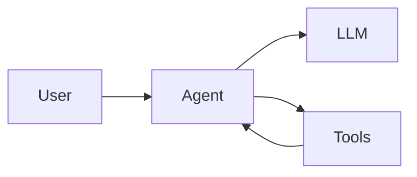
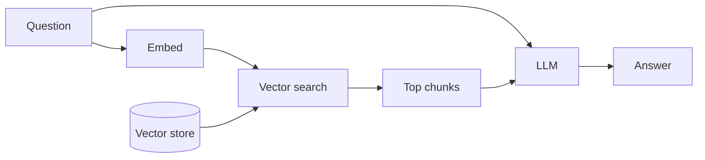

# Mermaid syntax. Pele rendering. Slidev clicks.

---

# A ` ```mermaid ` block, drawn by Pele



---

# A ` ```pele ` block in a narrow column

<div class="grid grid-cols-[1fr_320px] gap-8">
<div>

The same left-to-right flowchart turns top-to-bottom when its column is too narrow.

</div>
<div>

```pele
flowchart LR
  question[Question] --> retrieve[Retrieve documents]
  retrieve --> rerank[Rerank]
  rerank --> answer[Answer]
```

</div>
</div>

---
routeAlias: tool-loop
---

# Code and diagram, step by step

<div class="grid grid-cols-2 gap-8 items-center">
<div>

```python {1-2|3-4|5-7|*}{at:1}
def run(question):
    messages = [user(question)]
    while True:
        reply = llm(messages)
        if not reply.tool_calls:
            return reply.text
        messages += call_tools(reply.tool_calls)
```

</div>
<div>


</div>
</div>

---
routeAlias: rag-reveal
---

# A RAG flow, built up click by click


