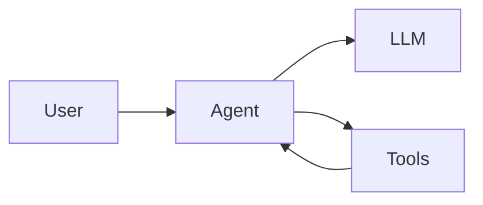
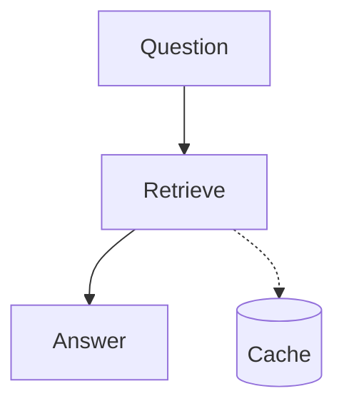
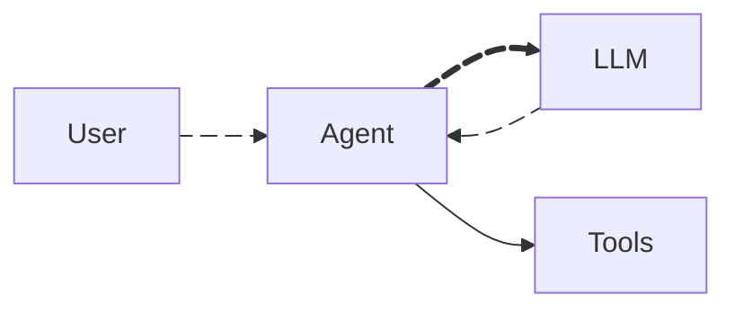

# Mermaid syntax. Pele rendering. Slidev clicks.

---

# A ` ```mermaid ` block, drawn by Pele



---

# A ` ```pele ` block in a narrow column

<div class="grid grid-cols-[1fr_320px] gap-8">
<div>

The same left-to-right flowchart turns top-to-bottom when its column is too narrow.

</div>
<div>

```pele
flowchart LR
  question[Question] --> retrieve[Retrieve documents]
  retrieve --> rerank[Rerank]
  rerank --> answer[Answer]
```

</div>
</div>

---
routeAlias: dark-mode
class: dark-mode
---

<script setup>
import { useDarkMode } from "@slidev/client";

const { isDark, toggleDark } = useDarkMode();
</script>

# Dark mode, without a re-render

<div class="flex items-center gap-4 mb-6">
  <button class="px-3 py-1 rounded border border-current opacity-80 hover:opacity-100" @click="toggleDark()">
    Switch to {{ isDark ? "light" : "dark" }} mode
  </button>
  <span class="opacity-60">or press <kbd>d</kbd></span>
</div>

<div class="grid grid-cols-2 gap-8">
<div>

`auto` follows the Slidev theme



</div>
<div>

`{theme: 'flexoki'}`


</div>
</div>

---
routeAlias: animated-edges
class: animated-edges
---

# Animated edges



Pele reads `animate: true` but draws the edge still; the addon moves its dashes. They stand still for viewers who prefer reduced motion.
