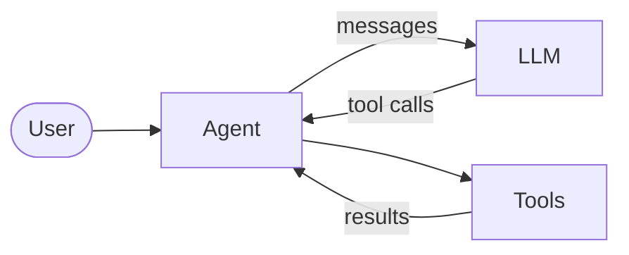
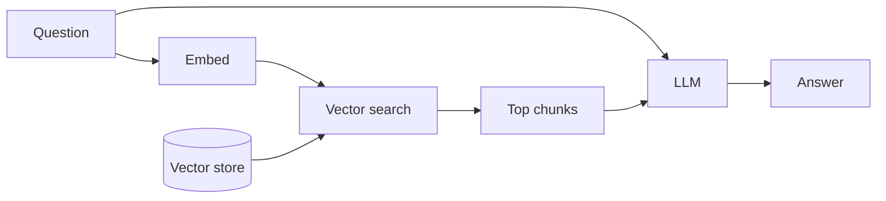
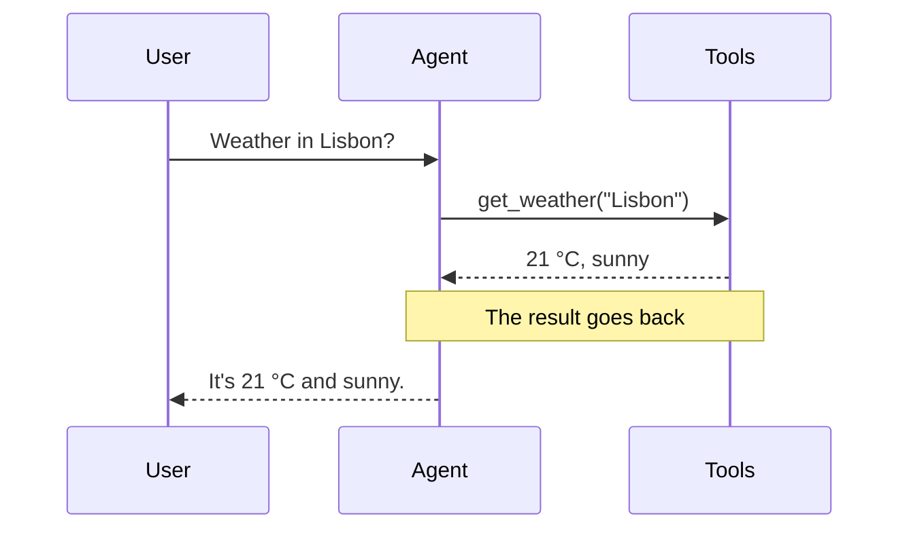
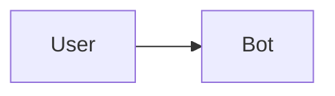
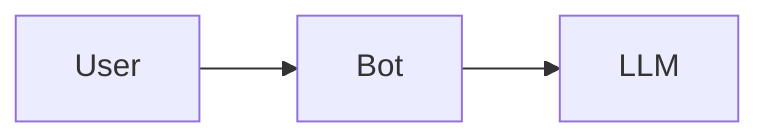

# Diagrams with slidev-addon-pele

The addon draws every ` ```mermaid ` and ` ```pele ` block in the deck (a **diagram block**) with Pele instead of mermaid.js. Write plain Mermaid syntax: everything Slidev's Mermaid docs teach still holds, including `{scale: 0.8}` and `{theme: 'neutral'}`. Diagrams fit the column they sit in (a left-to-right flowchart turns top-to-bottom in a narrow column) and follow the Slidev theme and dark mode.

## Steps

A diagram block steps on click with the grammar of Slidev's code line highlighting: `|` separates steps, `,` joins the ids of one step, `*` names every part. The first step shows before any click, and each later step takes one click. Steps come first, options after, each in its own braces: ` ```mermaid {user|agent,llm|*}{scale: 0.8} `.

**Focus mode** (the default) shows the whole diagram and emphasises the current step's parts while the rest recedes. **Reveal mode**, `{reveal: true}`, keeps every part hidden until its step arrives, so the diagram builds up; each step adds to what is already shown.

What an id names depends on the diagram type:

- **Flowchart**: node ids, the word before the brackets (`agent` in `agent[Agent]`), and subgraph ids. An edge lights up on its own once both its ends are active. To step an edge yourself, name it in the source (`user e1@--> agent`) and write `e1` in a step; once a step mentions it, it follows its steps instead of its ends.
- **Sequence**: message numbers, `1` for the first arrow in the source, and ranges like `2-4`. A note shows with the message before it. Participants stay visible throughout.
- **Every other type**: the ids Pele draws, such as class names, state ids, gantt task ids or pie slice labels. See [references/step-ids.md](references/step-ids.md).

Flowchart in focus mode:

````md

````

A flow built click by click in reveal mode:

````md

````

A sequence diagram, message by message:

````md

````

A code block and a diagram on the same slide step one after the other. To step them together, give both `{at:1}`, exactly as Slidev syncs two code blocks: ` ```python {1-2|3-4|*}{at:1} ` beside ` ```mermaid {user,agent|agent,llm|*}{at:1} `.

## Magic-move between versions

To grow or rearrange a diagram across clicks, use Slidev's ` ````md magic-move ` fence with diagram blocks inside. Each block is a **version**; each click glides to the next, matching parts by id, so keep a part's id the same in every version (`bot` here):

`````md
````md magic-move



````
`````

`{at}` and `{duration}` go on the outer fence, as in Slidev; `lines` and a `[title]` do nothing for diagrams and give a warning. Versions take no steps or options of their own and use the deck's preset; to step through a diagram, give it a slide of its own. The addon draws the fence only when every version is a diagram block it would draw; one handed-back or non-diagram version leaves the whole fence to Slidev, as code.

## Animated edges

Mark a flowchart edge with Mermaid's own syntax and the addon moves its dashes: `user e1@--> agent` then `e1@{ animate: true }`, or `e1@{ animation: fast }` / `slow`.

## Mermaid features Pele does not draw

Draw those blocks with mermaid.js: `{renderer: 'mermaid'}` on one ` ```mermaid ` block, or `pele: { mermaid: false }` in the headmatter for the whole deck (a block with `{renderer: 'pele'}` still draws with Pele). That covers HTML labels, click callbacks, Mermaid `themeVariables`, and configuration in `setup/mermaid.ts`, which only reaches mermaid.js. ZenUML goes to mermaid.js on its own, which draws it only with the `@mermaid-js/mermaid-zenuml` plugin registered; without it, `slidev export` of that slide hangs. mermaid.js cannot step, so a handed-back block draws whole.

## Options and presets

- Every option a block takes (`scale`, `theme`, `reveal`, `renderer`, `at`) and the deck settings under `pele:`: [references/options.md](references/options.md).
- Presets, dark mode, the `--pele-*` CSS variables and the classes to restyle steps: [references/presets.md](references/presets.md).

## Verify

Done means the dev server prints no `[pele]` line and every click of every diagram lands on the part you meant.

1. Run the deck (`slidev`, or the deck's `dev` script) and read the terminal. Each `[pele]` line names the file, the slide and the fix: an unknown step id lists the diagram's ids, an unknown option lists the valid ones. The same step message shows in red under the diagram.
2. Open each diagram slide at each click, `http://localhost:3030/<slide>?clicks=<n>` with `n` from 0 to the number of steps minus one. Diagrams draw a moment after the page loads, so wait for `.slidev-page-<slide> .pele-diagram svg` before reading (neighbouring slides are in the page too, hidden). The diagram's active parts carry the class `pele-step-active`; receding parts `pele-step-receding`; hidden parts `pele-step-hidden`. A slide that also has `v-click`s or code steps shifts the diagram's clicks unless the diagram has `{at}`.
3. A diagram Pele cannot read shows Pele's parse error in its place; fix the Mermaid syntax.
